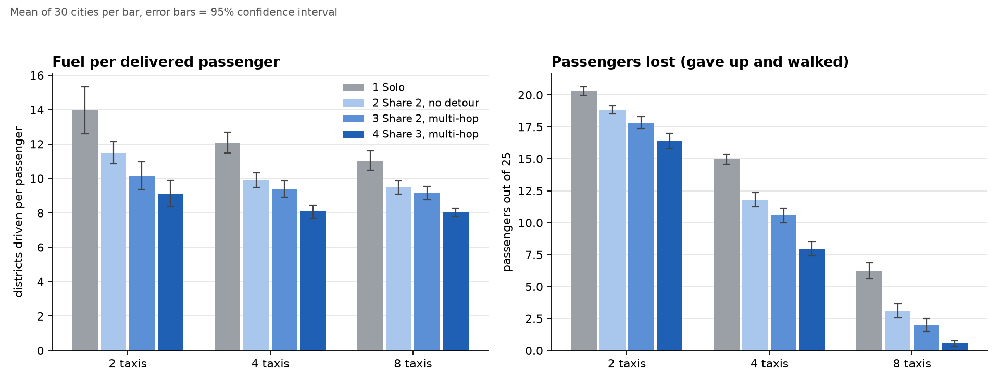

# City Taxi Carshare: a multi-agent ride-sharing simulation

An agent-based simulation of taxis and passengers in a small city, built with [Mesa](https://mesa.readthedocs.io/) in Python.
Taxis and passengers negotiate rides through a **call-for-proposal (CFP) protocol**, and taxis can share rides with up to 3 passengers.

The question I wanted to answer: **does ride sharing reduce fuel use and lost customers, and what does it cost passengers in time?**

M1 course project (multi-agent systems), Université Paris-Saclay. Full write-up in the [technical report](City_Taxi_Carshare_Simulation___Technical_Report.pdf).



## How the simulation works

**The city** is a 10 × 10 grid of districts. Distances are Manhattan distances (blocks), and the distance a taxi drives is used as the fuel / pollution measure.

**Passengers** start at a random district with a random destination and a random patience (18–35 steps). If no taxi picks them up in time, they give up and walk (4× slower than a taxi).

**Taxis** park when they have nothing to do instead of driving around, and follow a queue of pickup and drop-off stops.

**Negotiation protocol** (messages sent through each agent's mailbox):

1. `CFP`: a waiting passenger broadcasts a call for proposals with its origin and destination.
2. `PROPOSE`: every taxi with a free seat and a compatible route answers with a bid (its distance to the passenger, with a small bonus for taxis that already carry someone, so passengers prefer pooling).
3. `ACCEPT`: the passenger picks the lowest bid.
4. `CONFIRM` or `REJECT`: the taxi confirms if the seat is still free, otherwise the passenger starts again.
5. `CANCEL`: if the taxi is too late, the passenger cancels and the taxi frees the seat.

**When can a taxi share a ride?**
- *No detour*: the new passenger's pickup and drop-off must both lie on a shortest path the taxi already drives, so the trip gets no longer.
- *Multi-hop*: the taxi may change its route if the extra distance (pickup + gap between drop-offs) is at most 8 districts.

## Experiments

`experiments.py` compares four stages, each one adding a feature:

| Stage | Seats | Route change |
| --- | --- | --- |
| 1 Solo | 1 | – |
| 2 Share 2, no detour | 2 | no |
| 3 Share 2, multi-hop | 2 | yes |
| 4 Share 3, multi-hop | 3 | yes |

Each stage runs with **2, 4 and 8 taxis**, **25 passengers**, on **30 random cities** (seeds), for up to 150 steps.
The same 30 cities are used for every stage, so each sharing run is compared with the solo run of the *same* city (paired comparison).
Results are reported as mean ± 95% confidence interval.

## Results

Mean ± 95% CI over 30 seeds, 25 passengers, run to completion.

| Taxis | Stage | Arrived | Gave up | Wait | Travel | Door-to-door | Fuel / passenger | Saving vs solo (%) |
| --- | --- | --- | --- | --- | --- | --- | --- | --- |
| 2 | 1 Solo | 4.7 ± 0.3 | 20.3 ± 0.3 | 18.4 ± 0.9 | 8.2 ± 0.6 | 26.6 ± 0.9 | 14.0 ± 1.4 | — |
| 2 | 2 Share 2, no detour | 6.2 ± 0.3 | 18.8 ± 0.3 | 16.5 ± 0.7 | 10.0 ± 0.9 | 26.5 ± 1.2 | 11.5 ± 0.7 | 13.4 ± 7.6 |
| 2 | 3 Share 2, multi-hop | 7.2 ± 0.5 | 17.8 ± 0.5 | 17.1 ± 0.9 | 9.7 ± 0.6 | 26.7 ± 1.1 | 10.2 ± 0.8 | 24.2 ± 6.5 |
| 2 | 4 Share 3, multi-hop | 8.6 ± 0.6 | 16.4 ± 0.6 | 16.3 ± 1.0 | 13.5 ± 0.9 | 29.8 ± 1.2 | 9.1 ± 0.8 | 31.4 ± 6.6 |
| 4 | 1 Solo | 10.0 ± 0.4 | 15.0 ± 0.4 | 17.3 ± 0.7 | 7.8 ± 0.4 | 25.1 ± 0.7 | 12.1 ± 0.6 | — |
| 4 | 2 Share 2, no detour | 13.2 ± 0.6 | 11.8 ± 0.6 | 15.8 ± 0.6 | 9.7 ± 0.5 | 25.5 ± 0.7 | 9.9 ± 0.4 | 16.3 ± 5.6 |
| 4 | 3 Share 2, multi-hop | 14.4 ± 0.6 | 10.6 ± 0.6 | 16.1 ± 0.6 | 9.5 ± 0.5 | 25.7 ± 0.7 | 9.4 ± 0.5 | 21.1 ± 5.2 |
| 4 | 4 Share 3, multi-hop | 17.0 ± 0.5 | 8.0 ± 0.5 | 14.3 ± 0.5 | 12.7 ± 0.6 | 27.0 ± 0.8 | 8.1 ± 0.4 | 31.7 ± 4.7 |
| 8 | 1 Solo | 18.8 ± 0.6 | 6.2 ± 0.6 | 15.5 ± 0.5 | 7.8 ± 0.3 | 23.3 ± 0.5 | 11.0 ± 0.6 | — |
| 8 | 2 Share 2, no detour | 21.9 ± 0.6 | 3.1 ± 0.6 | 12.7 ± 0.5 | 9.9 ± 0.4 | 22.6 ± 0.6 | 9.5 ± 0.4 | 13.2 ± 3.6 |
| 8 | 3 Share 2, multi-hop | 23.0 ± 0.5 | 2.0 ± 0.5 | 12.6 ± 0.4 | 9.7 ± 0.4 | 22.3 ± 0.6 | 9.2 ± 0.4 | 16.2 ± 3.6 |
| 8 | 4 Share 3, multi-hop | 24.5 ± 0.2 | 0.5 ± 0.2 | 10.1 ± 0.4 | 12.0 ± 0.6 | 22.1 ± 0.7 | 8.0 ± 0.2 | 26.2 ± 3.1 |

Times are in simulation steps. Fuel = districts driven by the whole fleet.

### What I found

- Sharing saves fuel per passenger with every fleet size. With 3 seats and route changes, the saving is about 26–32% compared with solo rides in the same city.
- Sharing also loses fewer customers. With 4 taxis, the number of passengers who gave up drops from 15.0 to 8.0 out of 25, and with 8 taxis from 6.2 to 0.5.
- The cost is a longer ride: with 4 taxis, travel time goes from 7.8 to 12.7 steps because of detours. Waiting time goes down, so door-to-door time changes much less (25.1 to 27.0), and with 8 taxis it is even slightly shorter.
- Total fuel of the fleet goes *up* when sharing (e.g. 119.7 to 136.7 with 4 taxis), because the taxis serve many more passengers. That is why I compare fuel **per delivered passenger**.
- Even sharing without any detour saves 13–16%. Allowing route changes helps most when the fleet is small (24% vs 13% with 2 taxis).

### Limitations

- The city is a small grid with Manhattan distances, and taxis "jump" between stops instead of driving cell by cell.
- All passengers appear at the start; there is no continuous demand, pricing, or real traffic model.
- Fuel is approximated by distance driven.

## Run it

Python 3.10 or later.

```bash
pip install -r requirements.txt

solara run app.py          # interactive web interface
python experiments.py      # all experiments, 30 seeds (about one minute)
python experiments.py --seeds 10   # quicker test
```

The web interface lets you change the number of taxis and passengers, the taxi capacity, route changes and the random seed, and shows the grid, the metrics and a live log of the CFP messages.

## Files

| File | Content |
| --- | --- |
| `app.py` | Agents (Passenger, Taxi), model, metrics and the Solara web interface |
| `experiments.py` | Batch experiments, confidence intervals, table and figure |
| `results_raw.csv` | One row per run (stage × fleet size × seed) |
| `results_summary.csv` / `.md` | Mean and 95% CI per stage and fleet size |
| `results_figure.png` | Fuel per passenger and passengers lost, per stage |
| `City_Taxi_Carshare_Simulation___Technical_Report.pdf` | Technical report |
